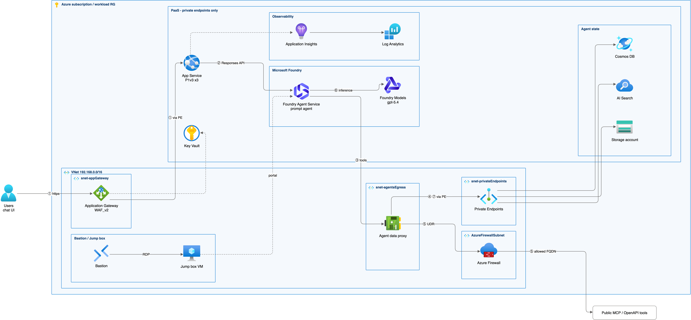

# mmd-azure-diagram

Mermaid で書いた構成図を、Azure 公式アイコンの構成図にする。



<sub>[examples/foundry-baseline.mmd](skills/mmd-azure-diagram/examples/foundry-baseline.mmd) から生成。</sub>

## 特徴

- **Mermaid が正本**: subgraph の入れ子と矢印のラベルはそのまま。Azure のサービス名のノードだけが
  公式アイコンになり、サブスクリプション・リソースグループ・VNet・サブネットの枠にもアイコンが付く。
  対応できない名前は推測せず一覧で知らせる。
- **矢印はアイコンを突き抜けない**: すべての矢印を、アイコン・ラベル・枠のタイトルを避けて引き直す。
  避けられなければ図を出さずにエラーで止まる。draw.io の出力は、draw.io 自身の描画でも検査する。
- **3 形式で出力**: PNG/SVG、編集できる draw.io、PowerPoint (16:9 のスライド 1 枚)。

## 必要なもの

| 必要なもの | 用途 |
| --- | --- |
| Python 3.10 以上、[uv](https://docs.astral.sh/uv/) | スクリプトの実行 |
| Node.js と `pnpm` (または `bun` / `npx`) | [mermaid-cli](https://github.com/mermaid-js/mermaid-cli) を動かす |
| [draw.io Desktop](https://www.drawio.com/) | PNG/SVG・draw.io の出力と検査 |
| Azure Architecture Icons | 構成図のアイコン。このリポジトリには含めない。Microsoft の[利用条件](https://learn.microsoft.com/azure/architecture/icons/) (構成図・研修資料・ドキュメントでの利用に限る) に同意したうえで、各自で取得する (使い方 1) |

## 使い方

```
/plugin install mmd-azure-diagram@mizuryu
```

Mermaid の構成図を渡して、Azure の構成図にするよう頼む。手動で実行する場合は
`skills/mmd-azure-diagram/` で:

```bash
# 1. アイコン集を取得して変換する (初回のみ。利用条件への同意を示す --accept-terms が必須)
python3 scripts/build_iconpack.py --accept-terms -o ~/.cache/mmd-azure-diagram/azure.json

# 2. Azure リソースをアイコンにし、配置を決める
python3 scripts/azurify.py diagram.mmd --icons ~/.cache/mmd-azure-diagram/azure.json

# 3. 矢印を引き直して書き出す (diagram.final.png, diagram.drawio, diagram.pptx)
uv run scripts/export.py diagram.svg --icons ~/.cache/mmd-azure-diagram/azure.json --png --pptx
```

## 制約

- 配置は Mermaid が決め、引き直すのは矢印だけ。矢印同士の交差は残ることがある。
- PowerPoint で吸着コネクタになるのは、アイコンの辺を独占でき、PowerPoint のカギ型で表せる
  矢印だけ。それ以外は折れ線で、図形を動かしても付いてこない。
- 現行の Microsoft のアイコン集には Microsoft Entra ID 単体のアイコンがない。
